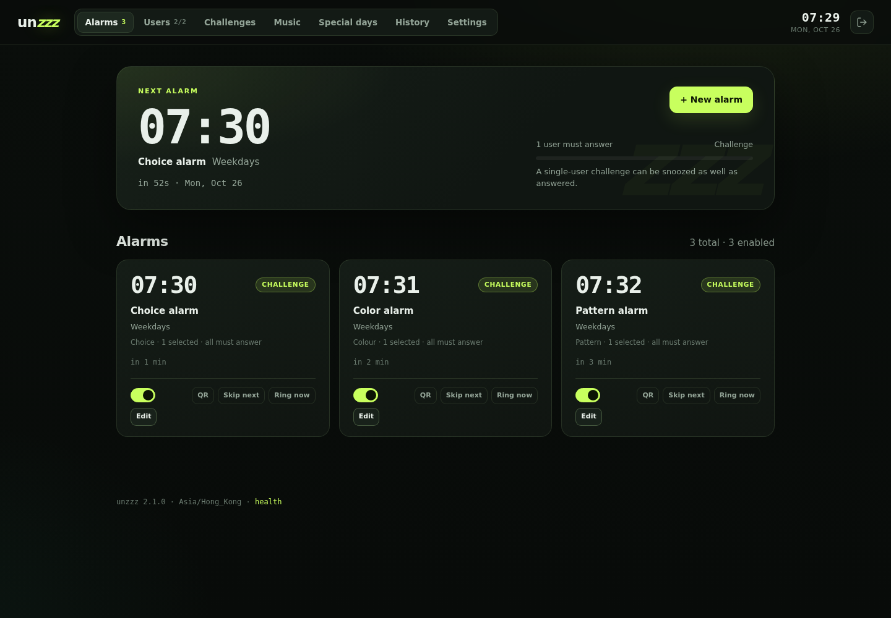
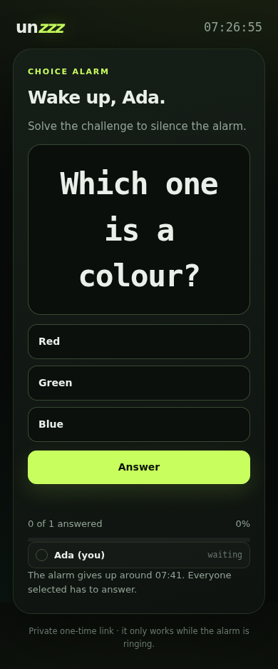

# unzzz

A small **server-side alarm clock** for Linux and Raspberry Pi. It rings from
the server's speaker, has a web control panel, and can require selected people
to open a shortlink and answer a question before the sound stops. Standard
alarms still snooze; multi-person challenges do not.

No cloud. No accounts. No Python packages. One process, one SQLite file,
uploaded music on disk, and the standard library.





More screens: [shared shortlink + QR](docs/shortlink.png) ·
[users](docs/users.png) · [question bank](docs/challenges.png) ·
[music](docs/music.png) · [alarm editor](docs/editor.png) ·
[choice](docs/choice.png) · [colour match](docs/color.png) ·
[pattern paint](docs/pattern.png) · [language switch](docs/language.png).

## Features

- **Standard alarms** — label, 24-hour time, weekdays or a one-time date,
  enable/pause, configurable snooze, stop from the panel.
- **Challenge alarms** — choose **1–6 users per alarm** (the Users list itself
  is not limited to six). Each selected user gets a private shortlink and a
  challenge. The alarm stops when **everyone selected** answers, or when a
  fixed number of correct answers is reached.
- **Six challenge types** — generated maths, text answer, multiple choice,
  random multiple choice, colour match, and pattern paint. Set how many
  challenges each person must pass per session.
- **Five UI languages** — English, 中文, 日本語, Français and Deutsch, selected
  from the top-right language menu. The choice is remembered per browser;
  user-written questions, choices and alarm labels are shown as entered.
- **Question bank** — the **Challenges** tab stores text questions and
  multiple-choice questions with 2–6 options. Text answers are compared
  ignoring case and extra whitespace; choice answers must match an option.
- **Skip the next ring** — every alarm card has **Skip next**. The next
  scheduled occurrence is recorded as *skipped* and beyond it the normal
  schedule continues. Press **Undo skip** to cancel.
- **Single vs. multi-person** — a challenge with one selected user can be
  snoozed; a challenge with several users cannot. Standard alarms always snooze.
- **Shared alarm shortlink + QR** — each challenge alarm gets a public,
  human-readable URL such as `http://192.168.5.19:8888/alarmmorning`. Open it,
  pick your name, and answer. The panel renders a QR code for it. Slugs can be
  random or user-defined.
- **Music** — upload WAV/MP3/OGG/FLAC/M4A/AAC/Opus tracks and choose one per
  alarm. The built-in two-tone beep remains the default. Each track has
  **Test on server** / **Stop** buttons for playback through the server's
  selected output device.
- **Alarm volume** — Settings shows the current system volume and a target
  alarm volume. The server saves the current level, applies the target while
  an alarm rings, and restores the saved level when the sound stops.
- **Link retirement** — private challenge links and the last-result view stop
  working a configurable number of minutes after an alarm stops (default 30).
- **Playback devices** — the Settings tab discovers ALSA PCMs and PulseAudio
  sinks and applies the selected device to aplay/mpv/paplay.
- **Special days** — import named CSV calendars with each date marked `work`
  or `holiday` (aliases: `working`, `rest`). A `work` Sunday rings; a `holiday`
  Monday stays quiet. Select a calendar per repeating alarm.
- **Users** — add, rename, pause, delete up to 200 accounts; every alarm can
  select at most six.
- **Lightweight** — stdlib only, ~30 MB RSS, SQLite WAL, one scheduler thread,
  one ring thread per active event, DST-aware scheduling.
- **Restart-safe** — schedules persist; missed alarms are recorded rather than
  ringing hours late; stale rings are closed after a crash.
- **Hardening** — PBKDF2 password, hashed sessions, login throttling, CSRF and
  origin checks, strict CSP, upload limits, token-redacted logs, systemd sandbox.

## How a challenge alarm works

1. You pick a challenge type, up to six users, and a finish condition:
   - **All selected users**, or
   - **A fixed number** of correct answers (1–6).
2. At the scheduled minute, unzzz creates an event and a challenge row for each
   selected active user. They share the alarm's shortlink/QR, or you can send
   each person their private `/s/<token>` link from the ringing dock.
3. A person solves the selected challenge type:
   - maths → enter the number;
   - text → enter the answer;
   - multiple choice → pick one option;
   - colour match → tap the swatch matching the target;
   - pattern paint → reproduce the small highlighted grid.
   Correct → their row is marked done. Wrong → a fresh challenge is issued.
   All-mode stops when the last selected person answers; count-mode stops as
   soon as the target is reached. Remaining links become read-only.
4. If nobody finishes within the “give up after” limit, the event is marked
   *timed out*. **Emergency stop** is available but logged.
5. A single-user challenge can also be snoozed, just like a standard alarm.

The shared link exposes the selected names so people can pick themselves. It is
a household convenience; the private per-person links are stricter. Use those
if the shared link could reach someone you do not trust.

## Where data lives

Everything mutable is kept in one data directory:

| File | Contents |
|---|---|
| `unzzz.sqlite3` | admin password hash, users, alarms, questions, settings, history |
| `beep.wav` | generated two-tone alarm sound |
| `music/` | uploaded music files |

The default depends on how unzzz is started:

- **systemd / root** → `/var/lib/unzzz`
- **normal user** → `$XDG_DATA_HOME/unzzz` (usually `~/.local/share/unzzz`)
- `--data-dir DIR` or `UNZZZ_DATA_DIR=DIR` overrides both.

The Debian package and `install.sh` use `/var/lib/unzzz`, owned by the
`unzzz` system user with mode `0750`. Code lives separately under
`/usr/lib/unzzz` (Debian package) or `/opt/unzzz` (`install.sh`). Upgrading
code never touches the data directory.

## Quick start (any Linux, no root)

```bash
git clone https://github.com/WillXLuke/unzzz.git unzzz
cd unzzz
./bin/unzzz serve --bind 127.0.0.1 --port 8888
# normal user data: ~/.local/share/unzzz
# add --data-dir DIR to keep it somewhere else
```

Open <http://127.0.0.1:8888/>, set the admin password, then:

1. Add people in **Users**.
2. Add questions in **Challenges** if you want custom questions.
3. Upload a sound in **Music** (optional).
4. Import a **Special days** CSV (optional).
5. Create an alarm and press **Ring now** to test it.

Python 3.9+ is required (Raspberry Pi OS Bookworm has 3.11). Nothing is
installed with pip. Tests:

```bash
python3 -m unittest discover -s tests -v
```

## Debian / Ubuntu / Raspberry Pi package (.deb)

Download or build the package matching the machine:

```bash
# 64-bit PC / server
sudo apt install ./unzzz_2.1.0_amd64.deb

# 64-bit Raspberry Pi OS
sudo apt install ./unzzz_2.1.0_arm64.deb
```

The package:

- installs code under `/usr/lib/unzzz` and `/usr/bin/unzzz`;
- creates the `unzzz` system user and `/var/lib/unzzz` (mode `0750`);
- installs and starts `unzzz.service` on port 8888;
- keeps data through upgrades and removal; even `purge` preserves
  `/var/lib/unzzz` (delete it yourself when you really want to erase it).

For compressed music install `mpv` (`sudo apt install mpv`); WAV playback only
needs `alsa-utils`, which the package depends on. Build both architectures
from a checkout with:

```bash
./packaging/build-deb.sh
# dist/unzzz_2.1.0_amd64.deb
# dist/unzzz_2.1.0_arm64.deb
```

## Raspberry Pi install

### 1. Prepare the Pi

Use Raspberry Pi OS Lite (Bookworm or newer), 64-bit for a Pi 3/4/5; 32-bit is
fine on a Pi Zero 2 W. SSH in, update, and check audio **before** installing:

```bash
sudo apt update && sudo apt upgrade -y
sudo apt install -y alsa-utils git

aplay -l
speaker-test -t sine -f 440 -c 1 -l 1
alsamixer        # F6 selects the card; M unmutes, arrows adjust PCM
```

For MP3/OGG/FLAC/M4A music, install a decoder player as well:

```bash
sudo apt install -y mpv        # recommended for compressed music
```

unzzz auto-detects players in this order:

- WAV / beep: **aplay → paplay → mpv → ffplay → play**
- Compressed music: **mpv → ffplay → paplay → play** (aplay is skipped)

### 2. Install as a service

```bash
git clone https://github.com/WillXLuke/unzzz.git unzzz
cd unzzz
sudo ./install.sh --with-audio
```

The script creates the `unzzz` system user, adds it to `audio`, copies code to
`/opt/unzzz`, stores data in `/var/lib/unzzz`, installs/starts the systemd unit,
and prints the panel URL. Re-running it upgrades the code without touching the
database. It does not install `mpv`; add that separately if you want compressed
music.

Open `http://<pi-ip>:8888/` from a phone on the same Wi-Fi. Find the IP with
`hostname -I`; `http://raspberrypi.local:8888/` often works too.

### 3. Verify

In the panel: **Settings → Play test beep**, or:

```bash
sudo -u unzzz /opt/unzzz/bin/unzzz doctor --data-dir /var/lib/unzzz
sudo systemctl status unzzz
journalctl -u unzzz -f
```

On a headless Pi with a USB speaker, the first `aplay` may take a second to open
the device. If `doctor` reports no player, install `alsa-utils` and restart.

## Panel guide

- **Alarms** — next alarm, countdown, cards with mode, selected users, music,
  special calendar, next occurrence, toggle, **QR**, **Ring now**, **Edit**.
- **Alarm editor** — label, time, repeat days or one-time date, standard vs
  challenge, 1–6 selected users, **challenge type** (maths, text, multiple
  choice, random multiple choice, colour match, pattern paint), **challenges
  per person** (1–10), finish condition (all or fixed number), public shortlink,
  music, special-days calendar, snooze limits, give-up limit.
- **Skip next** — one-shot suspension of the next occurrence, available on the
  alarm card. The history records a *skipped* event; the following occurrence
  is scheduled normally.
- **Users** — no six-user cap; add, rename, pause, delete. Paused users are
  skipped when an alarm rings.
- **Challenges** — add/edit/delete text or multiple-choice questions. Choice
  questions need 2–6 unique options plus the correct option. Import a CSV with
  `question,option a,option b,option c,option d,correct answer`. Alarms using
  text, choice or random-choice draw from the matching pool.
- **Music** — upload and preview tracks, then select one in an alarm. Each
  track has **Test on server** and **Stop** buttons; the test plays through the
  server's selected playback device. A track cannot be deleted while an alarm
  or active ring uses it.
- **Special days** — import named CSVs, see work/holiday counts and how many
  alarms use each calendar, and delete calendars (alarms fall back to weekdays).
- **History** — last 30 rings: outcome, answer ratio, reason, music.
- **Settings** — timezone, public base URL, challenge-link lifetime, target
  alarm volume, current system volume, playback device, sound test, admin
  password, version/data path.
- **Language menu** — top-right selector for English, 中文, 日本語, Français and
  Deutsch. It reloads once and is remembered in `localStorage`. User-written
  questions, choices and alarm labels stay as entered. On a minimal Pi/kiosk
  without CJK fonts, install `fonts-noto-cjk` so Chinese/Japanese render.

### Timezone and link host

Scheduling uses the configured timezone. Set it to the household's zone. If the
panel is reached through a hostname or reverse proxy, set **Public base URL**
(e.g. `http://raspberrypi.local:8888` or `https://alarm.example.com`) so shared
links and QR codes point at the right host. Empty means “use the browser's
address”.

## Music and playback devices

Uploaded files live in `UNZZZ_DATA_DIR/music/`. Limits: 25 MB per file, 200
files, and an extension allowlist. The panel preview uses HTTP Range requests.
The built-in beep is always available as “Built-in beep”.

- Music-tab **Test on server** plays a file through the same server player and
  device as an alarm; **Stop** ends that test.
- WAV → aplay (lightest) or another player.
- MP3/OGG/FLAC/M4A/AAC/Opus → mpv/ffplay/paplay; install `mpv` on a Pi.
- Device selection is saved as soon as you change it and applies to:
  - **aplay** → `-D <alsa-pcm>` (`hw:` is routed through `plughw:`)
  - **paplay** → `--device=<pulse-sink>`
  - **mpv** → `--audio-device=alsa/<pcm>` or `pulse/<sink>`
- The Settings test button shows the exact player error and works even when the
  current selection looks unavailable.
- A custom `UNZZZ_AUDIO_CMD` player command controls its own device; the
  Settings device selection is ignored in that mode.

## Challenge types

The alarm editor offers six types:

| Type | What the phone shows | Source |
|---|---|---|
| **Generated maths** | an arithmetic question | generated per person |
| **Text question** | a question + text input | Challenges pool, text kind |
| **Multiple choice** | a question + 2–6 option buttons | Challenges pool, choice kind |
| **Random multiple choice** | a random shared sequence from the choice pool | Challenges pool, choice kind |
| **Colour match** | a target swatch + four named colours | generated per person |
| **Pattern paint** | a highlighted 3×3 target + blank grid | generated per person |

Wrong answers issue a fresh challenge (and, for generated types, a new
pattern/colour pair). **Challenges per person** controls how many correct
challenges each selected person must pass; the alarm only marks that person
done after the last one. Math difficulty is fixed at normal and pattern size is
fixed at 3×3. A choice question's correct answer must exactly match one of its
options. Random-choice picks a shared sequence for the whole session, so all
participants see the same questions.

## Shared shortlinks and QR codes

A challenge alarm has a unique slug (lowercase a–z, 0–9, `-`, `_`, 3–40 chars):

```
http://192.168.5.19:8888/alarmmorning
```

- The editor can generate a random slug or you type one.
- Save the alarm, then press **QR** on its card (or **Link & QR** in the ringing
  dock) to show the QR and copy the URL.
- Opening the link while the alarm rings lists the selected users; tapping
  “I am …” redirects to that person's question. Before/after the ring it shows
  the next schedule or the last result.
- Changing the slug invalidates previously shared links/printed QR codes.
- Slugs are distinct from the private per-user `/s/<token>` links.
- After an event stops, its private challenge links and the shared page's
  last-result view expire after **Challenge link lifetime after stop**
  (Settings, default 30 minutes, `0` = immediately). The alarm's shared
  `/<slug>` link remains available for its next ring.

## Multiple-choice question CSV

In **Challenges → Import multiple choice**:

```csv
question,option a,option b,option c,option d,correct answer
Which one is a colour?,Red,Green,Blue,Yellow,b
How many days are in a week?,5,6,7,8,c
```

- Header optional; comma/semicolon/tab separators accepted.
- 2–6 options are accepted; with the standard format use four.
- Correct answer can be the letter (`a`–`d`), the 1-based option number, or the
  exact option text.
- Import is capped by the normal 200-question limit.
- Sample: [choice-questions-example.csv](docs/choice-questions-example.csv).

## Special days CSV

Each CSV becomes a named calendar. Format:

```csv
date,type,note
2026-01-01,holiday,New Year
2026-01-04,work,Make-up workday
2026-02-15,holiday,Spring Festival
```

- Dates: `2026-01-01`, `2026/1/1`, `2026.1.1` or compact `20260101`.
- Types: `work` or `working` (also `on`, `yes`, `1`) for a working day;
  `holiday` or `rest` (also `off`, `no`, `0`) for a rest day.
- A note is optional. A header row is optional. Delimiters comma, semicolon and
  tab are accepted.

The CSV parser is language-neutral. The panel can be switched between five
languages from the top-right menu; install `fonts-noto-cjk` on a minimal kiosk
if Chinese or Japanese text renders as boxes.

## CLI

```bash
./bin/unzzz serve --bind 0.0.0.0 --port 8888 --data-dir ./data
./bin/unzzz passwd --data-dir ./data          # prompt, or pipe a password
./bin/unzzz audio-test --data-dir ./data
./bin/unzzz doctor --data-dir ./data          # Python, timezone, DB, audio
./bin/unzzz version
```

Flags: `--no-audio` (silent test server), `--audio-cmd '<command>'`,
`--log-level DEBUG`.

## Configuration

| Variable | Default | Meaning |
|---|---|---|
| `UNZZZ_DATA_DIR` | `/var/lib/unzzz` (root) or `$XDG_DATA_HOME/unzzz` | SQLite DB, beep, uploaded music |
| `UNZZZ_BIND` | `0.0.0.0` | Listen address |
| `UNZZZ_PORT` | `8888` | Listen port |
| `UNZZZ_AUDIO_CMD` | auto | Custom player; `{file}` is substituted. `none` = silent. |
| `UNZZZ_VOLUME` | `90` | mpv volume; use `alsamixer` for aplay |
| `UNZZZ_PASSWORD` | — | Seed the admin password on a brand-new database |
| `UNZZZ_TRUST_PROXY` | `0` | Trust `X-Forwarded-For`/`Proto` behind a reverse proxy |
| `UNZZZ_SECURE_COOKIE` | `0` | Force `Secure` on the session cookie |
| `UNZZZ_LOG_LEVEL` | `INFO` | `DEBUG`, `INFO`, `WARNING`, `ERROR` |

Examples:

```bash
# USB DAC through mpv, lower volume
UNZZZ_AUDIO_CMD='mpv --no-video --really-quiet --volume=70 {file}' ./bin/unzzz serve
# Silent development server
UNZZZ_AUDIO_CMD=none ./bin/unzzz serve --data-dir /tmp/unzzz-dev
```

## Security notes

Designed for a trusted home LAN, not as a multi-tenant internet service.

- **Set a password immediately.** Before setup, `/` is open to anyone who can
  reach the port. Set `UNZZZ_PASSWORD` or finish setup first.
- **Use HTTPS if it leaves the house.** Put Caddy/nginx in front, preserve the
  `Host` header, and set `UNZZZ_TRUST_PROXY=1`.
- Sessions are random 256-bit tokens stored hashed, `HttpOnly`, `SameSite=Lax`,
  30-day expiry. Changing the password invalidates other sessions.
- Login failures are throttled per IP (5 tries / 5 minutes).
- Panel mutations require a session, an `X-Unzzz-Csrf: 1` header, and a
  same-origin `Origin` when sent.
- Public `/<slug>`, `/s/<token>`, `/qr/<slug>.svg` endpoints are
  capability URLs. The shared link lets anyone who has it claim an unanswered
  name; use private links if that matters.
- Uploads are admin-only, extension/size limited, and served as opaque files.
  CSV parsing is bounded.
- The stdlib HTTP server is deliberately used for the Pi dependency budget; it
  is not hardened for direct internet exposure.
- Keep logs in mind: challenge tokens are redacted from access logs.

Password recovery:

```bash
sudo -u unzzz /opt/unzzz/bin/unzzz passwd --data-dir /var/lib/unzzz
sudo systemctl restart unzzz
```

## Data, backup and reset

`UNZZZ_DATA_DIR` contains:

- `unzzz.sqlite3` — settings, password hash, sessions, users, questions, music
  metadata, calendars, alarms, events, challenges;
- `beep.wav` — regenerated if missing;
- `music/` — uploaded audio.

Backup with SQLite (and copy the music directory):

```bash
sudo sqlite3 /var/lib/unzzz/unzzz.sqlite3 ".backup '/tmp/unzzz-backup.sqlite3'"
sudo cp -a /var/lib/unzzz/music /tmp/unzzz-music-backup
```

Or stop the service and copy the whole directory. Reset by stopping the service
and deleting `unzzz.sqlite3*` (and optionally `music/`), then set a new password.

History is capped at 500 events; sessions expire after 30 days.

## Troubleshooting

**No sound.** The Settings test now saves the selected device before playing
and prints the player's exact stderr if it fails. Run `unzzz doctor` as the
`unzzz` user and check group membership (`id unzzz` includes `audio`),
`aplay -l`, `alsamixer`, and:

```bash
sudo -u unzzz aplay -D plughw:CARD=Headphones,DEV=0 /var/lib/unzzz/beep.wav
```

`hw:` devices are automatically sent through `plughw:` so the 22.05 kHz mono
beep can be converted. A USB speaker sometimes needs one `speaker-test` to wake
up. If you select a PulseAudio sink, remember that the system service runs as
`unzzz` and may not share your desktop user's PulseAudio session; an ALSA PCM
is the safer choice for a headless Pi.

**Uploaded music is silent.** WAV works with aplay; MP3/OGG/FLAC/M4A need
`mpv`/`ffplay`/`paplay`. If `command -v mpv` prints nothing, compressed music
cannot play at all — install it (`sudo apt install mpv`), restart the service,
and use **Music → Test on server** / **Stop**. Only `aplay` + `amixer` is a
valid WAV/beep setup, not a compressed-music setup.

**Volume does not change.** Volume control needs `amixer` (alsa-utils) for ALSA
or `pactl` (pulseaudio-utils/PipeWire) for PulseAudio. Settings shows the current
volume and the backend in use; an unavailable current volume means no mixer was
detected. For a PulseAudio sink, the system service may not share your desktop
session; prefer an ALSA device on a headless Pi.
Some USB speakers expose controls such as `Playback Volume Playback Volume`
instead of `Master`/`PCM`; unzzz discovers the available controls from
`amixer -c <card> controls` and tries the playback-volume control first.
Check it manually with:

```bash
cat /proc/asound/cards
amixer -c 2 controls
amixer -c 2 sget 'Playback Volume'
```

**A challenge link says “expired”.** Its event stopped more than the configured
**Challenge link lifetime after stop** ago (default 30 minutes; Settings). The
alarm's shared `/<slug>` link remains for future rings.

**Devices list is empty.** The panel lists `aplay -L` PCMs and PulseAudio
sinks. On Lite with only ALSA, you should at least see `default`/`sysdefault`.
If your DAC is missing, run `aplay -L` as the service user.

**Links/QR point to `127.0.0.1`.** Open the panel through the Pi's LAN address,
or set **Public base URL** in Settings.

**Wrong time / off by an hour.** Set the timezone in Settings; check
`timedatectl`.

**Alarm “missed”.** The server was not running within 2 minutes of the scheduled
time (or its clock jumped). It records the miss and schedules the next run.

**Special day does not fire.** Confirm the date is in the selected calendar,
the type is `work`, the alarm is repeating, and the alarm has a future active
day. One-time alarms ignore calendars.

**Shared link 404.** The alarm was deleted, the slug was changed, or the URL was
mistyped. Use the current QR/card link.

**Alarm skipped when it should ring.** Check the card/history for a *skipped*
event. Press **Skip next** again to undo before the occurrence arrives.

**Port in use.** Change the port in `/etc/systemd/system/unzzz.service` or pass
`--port`.

## How it is built

| Piece | File | Notes |
|---|---|---|
| HTTP API + routes | `unzzz/web.py` | `ThreadingHTTPServer`, regex router, static assets, uploads, QR |
| Storage | `unzzz/db.py` | One SQLite connection + `RLock`, WAL, in-place v1→v2→v3 migration |
| Scheduler/engine | `unzzz/engine.py` | 1 s ticker, one ring thread per event, targets, music |
| Time math | `unzzz/schedule.py` | `zoneinfo`, weekday masks, special calendars, validation |
| Challenge types | `unzzz/challenge_types.py` | maths/text/choice/random-choice/colour/pattern generation and checking |
| Question CSV | `unzzz/question_csv.py` | multiple-choice CSV import and answer-letter validation |
| Special days CSV | `unzzz/special_days.py` | work/holiday CSV import and aliases |
| Auth | `unzzz/auth.py` | PBKDF2-SHA256, hashed sessions, throttle |
| Sound | `unzzz/audio.py` | WAV synthesis, music formats, device args, preview/test subprocesses |
| Volume | `unzzz/volume.py` | amixer/pactl target volume, save/restore, crash recovery |
| QR | `unzzz/qrcodegen.py` | vendored Project Nayuki QR generator (MIT) |
| Panel | `unzzz/assets/` | hand-written HTML/CSS/JS, no build step |
| Languages | `unzzz/assets/i18n.js` | English source text, zh/ja/fr/de dictionaries, client-side switch |
| Debian package | `packaging/` | amd64/arm64 `.deb` staging, maintainer scripts, systemd unit |
| Tests | `tests/` | unit + integration, including full multi-user flows |

The ticker reads `next_fire` and event states once per second. Ringing is a
thread that plays the selected file, waits, and repeats until its stop event is
set. There is no queue and no cron.

## License

MIT. See [LICENSE](LICENSE). `unzzz/qrcodegen.py` is by Project Nayuki, also
MIT-licensed; its header is preserved.
